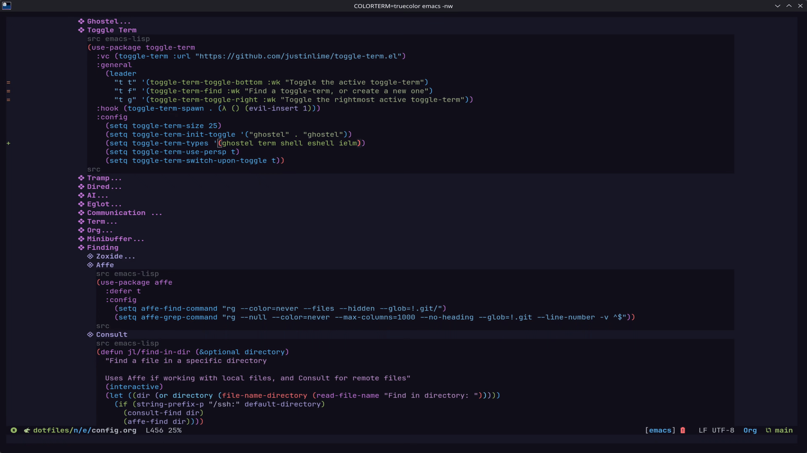

* Table Of Contents :toc_4:
- [[#toggle-term][Toggle Term]]
  - [[#installation][Installation]]
    - [[#melpa][Melpa]]
    - [[#use-package-vc][Use Package VC]]
  - [[#usage][Usage]]
    - [[#functions][Functions]]
    - [[#variables][Variables]]

* Toggle Term
[[https://melpa.org/#/toggle-term][file:https://melpa.org/packages/toggle-term-badge.svg]]

=toggle-term.el= is an Emacs package inspired by [[https://github.com/akinsho/toggleterm.nvim][toggleterm.nvim]],
allowing you to spawn a persistent =term=, =vterm=, =eat=, =ghostel=, =shell=, =eshell=, or =ielm= 
at the bottom of the frame and switch between them when needed.

** Installation
*** Melpa
*As of 05/26/24 toggle-term.el is part of the MELPA*

Just add the following to your =init.el= if you already have 
the *MELPA* added:
#+begin_src emacs-lisp
  (use-package toggle-term
    :bind (("M-o f" . toggle-term-find)
           ("M-o t" . toggle-term-term)
           ("M-o v" . toggle-term-vterm)
           ("M-o a" . toggle-term-eat)
           ("M-o a" . toggle-term-ghostel)
           ("M-o s" . toggle-term-shell)
           ("M-o e" . toggle-term-eshell)
           ("M-o i" . toggle-term-ielm)
           ("M-o o" . toggle-term-toggle))
    :config
      (setq toggle-term-size 25)
      (setq toggle-term-switch-upon-toggle t))
#+end_src
*** Use Package VC
If you manage your config with =use-package=, you can install toggle-term straight from its repository using =:vc=:

#+begin_src emacs-lisp
  (use-package toggle-term
    :vc (toggle-term :url "https://github.com/justinlime/toggle-term.el")
    :bind (("M-o f" . toggle-term-find)
           ("M-o o" . toggle-term-toggle)
           ("M-o t" . toggle-term-term)
           ("M-o s" . toggle-term-shell))
    :hook (toggle-term-spawn-hook . (lambda () (evil-insert 1)))
    :config
      (setq toggle-term-size 25)
      (setq toggle-term-init-toggle '("my-terminal" . "term"))
      (setq toggle-term-use-persp t)
      (setq toggle-term-switch-upon-toggle t))
#+end_src
** Usage
*** Functions
Toggle-term provides the following main functions:

| Function | Description |
|----------+-------------|
| =toggle-term-find= | Switch to an active toggle, or create a new one (when creating, it prompts for a name, then the side to spawn it on, then a type). Each toggle's side is shown next to its name, so typing a side like =left= narrows the candidates. The type prompt is filtered by =toggle-term-types= and skipped when that list holds a single type. |
| =toggle-term-toggle= | Toggle the *last used* toggle, whatever side it is on. When called from inside a toggle window, that toggle is marked as most recently used and hidden instead. |
| =toggle-term-toggle-left= | Toggle the most recently used *left-side* toggle, or create one. |
| =toggle-term-toggle-right= | Toggle the most recently used *right-side* toggle, or create one. |
| =toggle-term-toggle-top= | Toggle the most recently used *top-side* toggle, or create one. |
| =toggle-term-toggle-bottom= | Toggle the most recently used *bottom-side* toggle, or create one. |

Each toggle remembers the side it was spawned on, so multiple toggles on =different= sides can be shown at the same time; two toggles can never occupy the same side simultaneously.

The following helper functions are included for use with keybindings, spawning a toggle of a fixed type named =toggle-term-<type>=:

| Function | Description |
|----------+-------------|
| =toggle-term-term= | Toggle a *term*, named =toggle-term-term=. |
| =toggle-term-vterm= | Toggle a *vterm*, named =toggle-term-vterm=. |
| =toggle-term-ghostel= | Toggle a *ghostel*, named =toggle-term-ghostel=. |
| =toggle-term-eat= | Toggle an *eat*, named =toggle-term-eat=. |
| =toggle-term-shell= | Toggle a *shell*, named =toggle-term-shell=. |
| =toggle-term-eshell= | Toggle an *eshell*, named =toggle-term-eshell=. |
| =toggle-term-ielm= | Toggle an *ielm*, named =toggle-term-ielm=. |

*** Variables
| Variable | Default | Description |
|----------+---------+-------------|
| =toggle-term-size= | =40= | Percentage of the window that a toggle occupies. Values too high or too low may cause unexpected behavior. |
| =toggle-term-remember-resize= | =t= | Remember each toggle window's size when it is hidden and reapply it when the toggle is shown again. |
| =toggle-term-side= | =bottom= | Default side for toggles that have not recorded a side yet (=left=, =right=, =top=, or =bottom=). When creating a toggle interactively with =toggle-term-find=, the side is prompted for right after the name instead. |
| =toggle-term-types= | =(term vterm ghostel eat shell eshell ielm)= | Which toggle types =toggle-term-find= offers when creating a new toggle. Only loadable types are shown (if none are loadable, all configured ones are offered); when the list holds exactly one type, the type prompt is skipped. |
| =toggle-term-switch-upon-toggle= | =t= | Whether to switch to the toggle window upon spawning. |
| =toggle-term-use-persp= | =auto= | Integrate with perspective.el; enabled automatically when =persp-mode= is active. |
| =toggle-term-init-toggle= | =nil= | An initial toggle spawned the first time =toggle-term-toggle= is used, as =("name" . "type")= or =("name" "type" side)=. It never prompts and defaults to =bottom= when no side is given. |
| =toggle-term-spawn-hook= | =nil= | Hook run after a toggle spawns/opens its window (e.g. to enter insert mode). |
| =toggle-term-close-hook= | =nil= | Hook run after a toggle closes/hides its window. |
